# TrackerUI (`v1.19.2`) — Complete User Manual & Reference Guide

Welcome to the official **TrackerUI User Manual**. TrackerUI is a standalone, zero-build Progressive Web App (PWA) purpose-built for managing daily support requests, multi-department Excel workbooks, editable scratch spreadsheets with live `=FILTER` array formulas, and supervisor `(VIEW ONLY)` mirror workbooks directly inside your local or OneDrive folders.

---

## 📑 Table of Contents

1. [Browser Requirements & Getting Started](#1-browser-requirements--getting-started)
2. [Workspace Layout, Navigation Hierarchy & Display Modes](#2-workspace-layout-navigation-hierarchy--display-modes)
3. [Connecting Folders, Dual-Write Mirroring, Multi-Tab Locking & Fail-Safe Saves](#3-connecting-folders-dual-write-mirroring-multi-tab-locking--fail-safe-saves)
4. [The Tools & Setup Menu (`⚙️ Tools & Setup ▾`)](#4-the-tools--setup-menu-️-tools--setup-)
5. [Daily Request Management, Row Numbers, Split-Pill Copy & Status Highlights](#5-daily-request-management-row-numbers-split-pill-copy--status-highlights)
6. [Time-Saving Editor Power Tools (`🎯 Grab Ticket`, `📥 Pull Prior`, `🔄 Sync Forward`)](#6-time-saving-editor-power-tools--grab-ticket--pull-prior--sync-forward)
7. [Multi-Department Trackers, Custom Schemas & Lockable Form Layout](#7-multi-department-trackers-custom-schemas--lockable-form-layout)
8. [Ticket Details & Multi-Day Aggregated Timeline](#8-ticket-details--multi-day-aggregated-timeline)
9. [Searching, Sorting, Like-Item Filtering, Batch Actions & Row Copy/Paste](#9-searching-sorting-like-item-filtering-batch-actions--row-copypaste)
10. [Smart Daily Rollover, Overdue Aging & Carryover Engine](#10-smart-daily-rollover-overdue-aging--carryover-engine)
11. [Workbook Scratch Sheets (Cell Types, Fill Handle, Copy + `Enter` & `Auto-Filter Lists`)](#11-workbook-scratch-sheets-cell-types-fill-handle-copy--enter--auto-filter-lists)
12. [Scratch Sheet Excel Functions, Formula Syntax & Dynamic Array Reference](#12-scratch-sheet-excel-functions-formula-syntax--dynamic-array-reference)
13. [Supervisor Tools (`View-Only Inspector` & `Multi-Workbook Master Rollup`)](#13-supervisor-tools-view-only-inspector--multi-workbook-master-rollup)
14. [Backup, Portable `.json` Config & PWA Updates](#14-backup-portable-json-config--pwa-updates)
15. [Quick Reference: Where to Click & Keyboard Shortcuts](#15-quick-reference-where-to-click--keyboard-shortcuts)

---

## 1. Browser Requirements & Getting Started

> [!IMPORTANT]
> **Use Google Chrome in Desktop Mode:** TrackerUI relies on the Chromium **File System Access API** (`window.showDirectoryPicker`) to read and write `.xlsx` files directly in your local or OneDrive folders. If you open the app in another browser (Edge, Firefox, Safari, Brave) or in mobile viewport mode, a compatibility alert notifies you that TrackerUI is designed specifically for **Google Chrome in Desktop Mode**.

### First-Time Startup Steps
1. Open TrackerUI in **Desktop Google Chrome**.
2. In the top header bar, click the blue **`Select Agent Folder`** button.
3. Choose the folder on your computer or OneDrive containing your monthly `.xlsx` tracker workbooks (for example, `Agent_Trackers\`).
4. When Chrome prompts **"Let site view files?"** and **"Save changes to original files?"**, click **View files** / **Allow**.
5. TrackerUI stores directory handles per workspace tab inside browser `IndexedDB` so future sessions reconnect automatically (when **`Auto-Reconnect Folders on Startup`** is enabled) or with **1 click**.

---

## 2. Workspace Layout, Navigation Hierarchy & Display Modes

TrackerUI organizes your workspace into a clear **top-to-bottom parent-child hierarchy** so you always know which department workbook and which worksheet tab you are viewing:

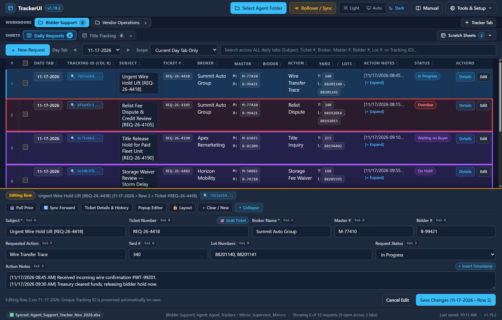

### Visual Anatomy (Top to Bottom)

| Zone | UI Location | Purpose & Where to Click |
| :--- | :--- | :--- |
| **1. Top Header Bar** | Very top of window | Switch monthly `.xlsx` files via **`Workbook`**, click **`Select Agent Folder`** / **`Reconnect Folder`**, launch **`Rollover / Sync`**, switch **`Light` / `Auto` / `Dark`**, open **`Manual`**, or open **`⚙️ Tools & Setup ▾`**. |
| **2. `Workbooks` Bar** | Level 1 bar (below Header) | Switch between separate department tracker profiles (e.g., **`Bidder Support`** vs. **`Vendor Operations`**). Click **`+ Tracker Tab`** on the right to add another department workbook. |
| **3. `Sheets` Bar** | Level 2 bar (below `Workbooks`) | Switch between views **inside** the active workbook: **`Daily Requests`** (all `MM-DD-YYYY` tabs) and any open **Scratch Sheets** (`Title Tracking`, `Lot Audit`, etc.). Click **`Scratch Sheets ▾`** on the right to open or create scratch sheets. |
| **4. Controls & Search Bar** | Above the table | Click **`+ New Request`**, use **`📥 Paste Row(s)`** when rows are copied, step dates via **`◀` / `▶`** around **`Day Tab`**, switch **`Scope`** (`Current Day Tab Only` vs. `All Daily Tabs`), or search in the **Global Search Box**. |
| **5. Quick Date Pill Strip** | Below Controls *(Ultrawide `> 1920×1080`)* | Displays clickable `MM-DD-YYYY` pills ordered oldest left → newest right with request counts. On **`1920×1080` and smaller screens**, this strip automatically hides (use the **`Day Tab` dropdown** and **`◀` / `▶` stepper buttons**) and vertical padding compacts to maximize visible table rows. |
| **6. Main Requests Table** | Center workspace | Excel-like left-hand row numbers (`#`), batch selection checkboxes, Tracking IDs (`🔍`), split-pill filter/copy cells, color-highlighted `Overdue` / `Waiting` rows, and `Details` / `Edit` buttons. |
| **7. Bottom Editor Dock** | Pinned above Status Bar | Instant request creation & row editing without hiding the table. Click **`▾ Collapse`** (or the dock header bar) to fold into a slim bar. |
| **8. Bottom Status Bar** | Bottom edge of window | Displays sync status (`✅ Synced`), fail-safe recovery buttons (**`💾 Retry Primary Save`** / **`Retry Mirror Sync`**), active Agent & Supervisor folder summary, open counts, last save timestamp, and current app version (**`v1.19.2`**). |

---

## 3. Connecting Folders, Dual-Write Mirroring, Multi-Tab Locking & Fail-Safe Saves

TrackerUI combines **Dual-Write Mirroring**, **Browser Multi-Tab Session Locking**, and **IndexedDB Fail-Safe Staging** to keep Excel files safe from lockups and race conditions.

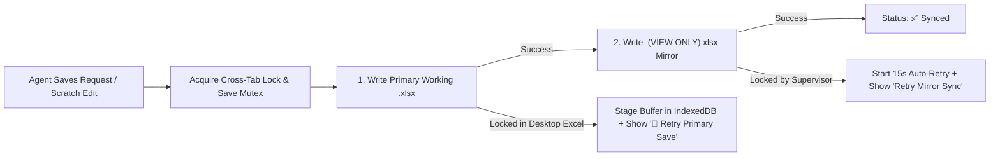

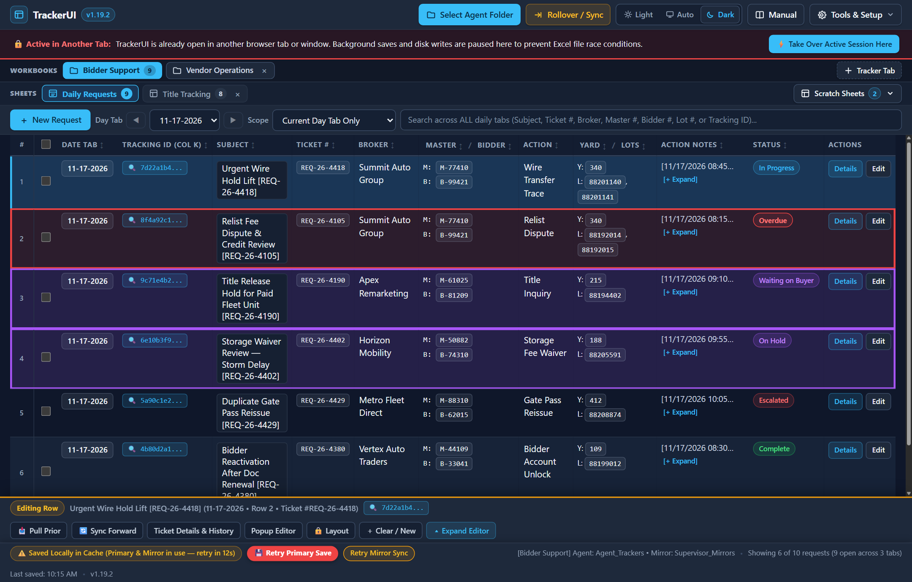

### How File Safety Protections Work
1. **Automatic File Filtering**: When scanning your Agent Folder, TrackerUI excludes Excel lock files (`~$*`) and mirror files (`*(VIEW ONLY).xlsx`) so you only open working `.xlsx` files.
2. **Supervisor `(VIEW ONLY).xlsx` Mirror**: Every save automatically writes an identical `<Workbook Name> (VIEW ONLY).xlsx` copy to your **Supervisor Folder** (or alongside your working file if no separate folder is configured).
3. **Non-Blocking Mirror Auto-Retry**: If a supervisor has `(VIEW ONLY).xlsx` open in Desktop Excel, your working `.xlsx` save still succeeds immediately. TrackerUI starts a **15-second background countdown** (up to 20 automatic retries) and surfaces a **`Retry Mirror Sync`** button on the bottom-left status bar.
4. **Fail-Safe Primary Save Cache (`💾 Retry Primary Save`)**: If Desktop Excel has your *working* `.xlsx` file locked during a save, TrackerUI stages the exact workbook bytes inside `IndexedDB` so **zero edits are lost**. Close Desktop Excel and click **`💾 Retry Primary Save`** in the bottom-left status bar (or accept the recovery prompt if you reload).
5. **Multi-Tab Standby Lock & External Modification Guard**: Opening TrackerUI in a second browser tab automatically places the duplicate tab into **Read-Only Standby Mode** (`🔒 Active in Another Tab`), pausing auto-saves and mirror retries to prevent Excel corruption. Click **`⚡ Take Over Active Session Here`** to safely claim the active session and reload fresh data from disk. Before writing any file, TrackerUI also checks file modification timestamps to warn if the workbook was edited externally in Excel.

---

## 4. The Tools & Setup Menu (`⚙️ Tools & Setup ▾`)

Click **`⚙️ Tools & Setup ▾`** in the top-right header to configure appearance, directory paths, workbook creation, custom column schemas, and day tab operations:

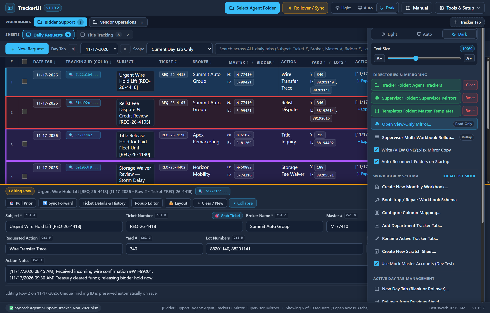

### Complete Menu Breakdown

#### 1. Appearance & Display
- **`Light` / `Auto` / `Dark`**: Switch color themes anytime.
- **`Text Size` (`A−` / Slider / `A+`)**: Scale UI typography, table cells, and inputs proportionally from **85% to 125%**, with **`Reset`** to return to `100%`.

#### 2. Directories & Mirroring
- **`Tracker Workbooks Folder...`**: Change your working `.xlsx` directory (hover to inspect the connected path; click **`Clear`** to forget the saved handle).
- **`Supervisor Folder`**: Assign a dedicated shared folder for `(VIEW ONLY).xlsx` mirror files (or **`Reset`** back to saving mirrors in your Agent folder).
- **`Templates Folder`**: Point TrackerUI to a master `.xlsx` templates directory for cloning new monthly workbooks.
- **`Open View-Only Mirror...`**: Inspect the `(VIEW ONLY).xlsx` snapshot safely in-app.
- **`Supervisor Multi-Workbook Rollup...`**: Aggregate and categorize requests across all agent workbooks in a folder.
- **`Write (VIEW ONLY).xlsx Mirror Copy`** & **`Auto-Reconnect Folders on Startup`**: Quick per-tab mirror toggle and startup folder reconnection preference.

#### 3. Workbook & Schema
- **`Create New Monthly Workbook...`**: Clone from any `.xlsx` in your **Templates Folder** or bootstrap a fresh workbook in memory with `template`, `validation lists`, and today's `MM-DD-YYYY` tab.
- **`Bootstrap / Repair Workbook Schema`**: Non-destructively repair incomplete workbooks without touching existing data.
- **`Configure Column Mapping...`**: Inspect Row-1 headers, assign semantic roles (`Primary`, `Status`, `Notes`, `Ticket #`, `Secondary`), and toggle per-column **`📋 Copy`** buttons.
- **`Add Department Tracker Tab...`** / **`Rename Active Tracker Tab...`**: Manage independent workbook tabs in the **`Workbooks`** bar.
- **`Create New Scratch Sheet...`**: Add a new freeform spreadsheet tab or start from the **Title Tracking + Red/Yellow/Green `=FILTER` Side Lists** starter layout.
- **`Use Mock Master Accounts (Dev Test)`**: Supply sample Broker ↔ Master # ↔ Bidder # auto-fill records during offline/dev testing.

#### 4. Active Day Tab Management
- **`New Day Tab (Blank or Rollover)...`**: Create a blank `MM-DD-YYYY` tab or immediately roll over unfinished requests into it.
- **`Rollover from Previous Sheet...`**: Pre-set rollover to carry items strictly from the immediately preceding `MM-DD-YYYY` sheet.
- **`Rename Current Day Tab...`** / **`Delete Current Day Tab...`**: Rename or delete `MM-DD-YYYY` daily sheets (reference sheets stay protected). All daily tabs stay automatically ordered chronologically left-to-right.

#### 5. Row Management, Config & Cache
- **`Batch Delete Requests Mode`**: Toggle checkbox deletion mode with confirmation banner.
- **`Export Workspace Config (.json)` / `Import Workspace Config (.json)...`**: Portable backup/restore for tracker profiles, schemas, and custom dock layouts.
- **`User Manual & Reference Guide...`** & **`Check for Updates & Clear Cache`**: Open this manual or clear cached PWA scripts/styles to load **`v1.19.2`** updates.

---

## 5. Daily Request Management, Row Numbers, Split-Pill Copy & Status Highlights

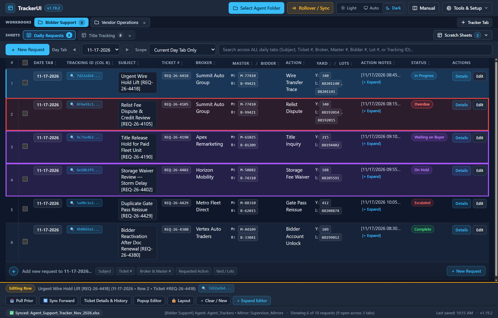

### Visual Row Cues & Table Ergonomics
1. **Excel-Style Left-Hand Row Numbers (`#`)**: Every table row displays sequential index numbers (`1..N`) on the left edge (hovering reveals the exact underlying Excel worksheet and row number).
2. **Urgency Color-Coding (`Overdue` & `Waiting / On Hold`)**:
   - **`Overdue` Rows**: Render with both a bold **red perimeter outline** and a **red row background tint** so overdue items stand out immediately in both the Daily Table and Rollover Preview.
   - **`Waiting` / `Waiting on Buyer` / `On Hold` Rows**: Render with a **purple perimeter outline** and a **purple row background tint** so paused/buyer-pending requests stay distinct from `In Progress` and `Pending` items without ever being dropped on rollover.
3. **Integrated Split-Pill Copy Buttons**:
   - On **Email Subject**, **Ticket #**, **Master #**, **Bidder #**, **Yard #**, and individual **Lot #** tokens:
     - **Click the left value text** → 1-click **Like-Item Filter** across all tabs.
     - **Hover and click the right `Copy` icon inside the pill** → copies the exact value to your clipboard with a toast confirmation (without triggering the filter!).
   - *(On Custom Department Trackers, customize which columns show copy buttons inside **`Configure Column Mapping...`**).*

### Creating & Editing Requests
- **Create**: Click **`+ New Request`** in Controls (or **`+ Clear / New`** in the Bottom Dock header).
- **Edit**: **Single-click any table row** to load it into the **Bottom Editor Dock**, or click **`Edit`** (or **`Popup Editor`**) for a centered dialog.
- **Bidirectional Master Account Auto-Fill**: Typing a **Broker Name** (`Col C`) fills **Master #** (`Col D`) and **Bidder #** (`Col E`), and typing a **Master #** reverse-fills Broker Name and Bidder # (learning dynamically from `Master Accounts` or past tabs).
- **Automatic Uppercase & Immutable UUIDv4 (`Col K`)**: `Ticket #`, `Master #`, `Bidder #`, and `Yard #` save uppercase automatically; hidden Column K assigns an immutable 36-character UUIDv4 (`🔍 8f4a92c1...`) that stays locked even when Subject or Ticket # changes.
- **Timestamps**: Click **`+ Insert Timestamp`** above Action Notes to append `[MM/DD/YYYY HH:MM AM/PM]`.

---

## 6. Time-Saving Editor Power Tools (`🎯 Grab Ticket`, `📥 Pull Prior`, `🔄 Sync Forward`)

Located in the **Bottom Editor Dock** and **Popup Modal Editor**:

1. **`🎯 Grab Ticket` (Above Ticket Number)**: Extracts bracketed, hyphenated ticket IDs such as `[REQ-26-4418]` directly from **Subject**, strips brackets, normalizes to uppercase, and merges comma-delimited into **Ticket Number** without duplicates.
2. **`📥 Pull Prior` (Dock / Modal Header)**: Searches older `MM-DD-YYYY` tabs for the latest matching request (by UUID, Ticket #, Broker/Master/Lot identity, or Subject) and fills **only currently blank fields** while merging new Ticket Numbers.
3. **`🔄 Sync Forward` (Dock Header & Ticket Details Modal)**: When editing a request that spans multiple daily tabs, **`🔄 Sync Forward`** pushes newly entered Ticket #s, Master #s, Bidder #s, or Lot #s forward onto newer rolled-over daily tabs non-destructively after a preview confirmation.

---

## 7. Multi-Department Trackers, Custom Schemas & Lockable Form Layout

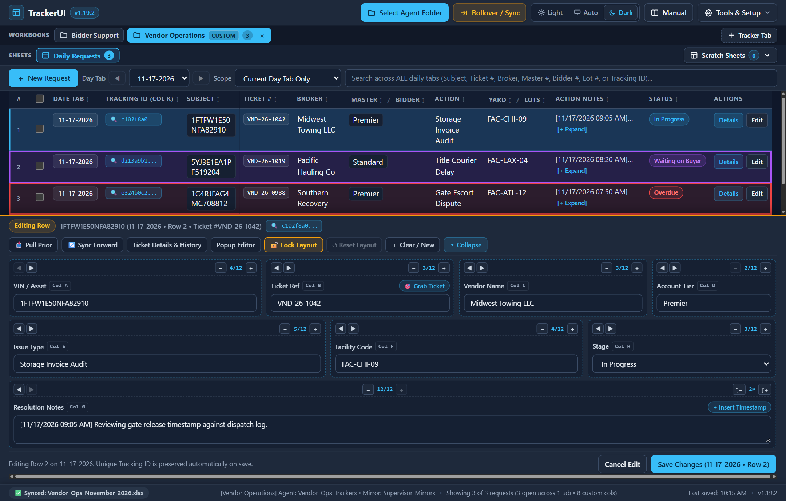

### Managing Multiple Department Trackers (`Workbooks` Bar)
- Click **`+ Tracker Tab`** on the far right of the **`Workbooks`** bar (or inside `⚙️ Tools & Setup ▾`) to add another department tab (`Vendor Operations`, `Title Desk`, etc.).
- Every tab maintains its own **Agent Folder**, **Supervisor Folder**, active workbook, and custom schema.
- **Double-click** any tab in the `Workbooks` bar to rename it, or click **`×`** to close secondary tabs without touching disk files.

### Adjusting the 12-Column Form Grid (`🔒 Layout` → `🔓 Lock Layout`)
1. Click **`🔒 Layout`** in the Bottom Editor Dock header to unlock customization controls (the button turns amber: **`🔓 Lock Layout`**).
2. Click **`◀` / `▶`** on any field card to reorder fields visually in the app while leaving Excel column positions (`Col A`, `Col B`, etc.) strictly untouched.
3. Click **`−` / `+`** (from `2/12` to `12/12`) or drag the right edge handle of a field card to resize its width; click **`↕−` / `↕+`** on Notes fields to adjust textarea rows (`1r`–`6r`).
4. Click **`🔓 Lock Layout`** to lock and save per schema, or **`↺ Reset Layout`** to restore smart defaults.

### Configuring Custom Schemas & Per-Column Copy Toggles

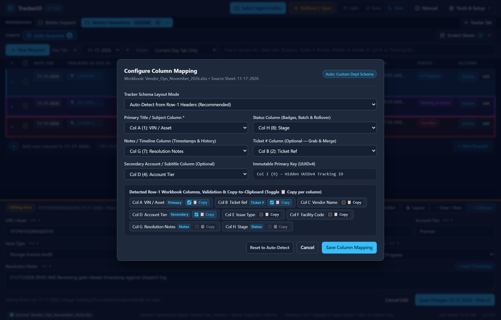

- Open **`⚙️ Tools & Setup ▾` → `Configure Column Mapping...`** to inspect Row-1 headers on custom workbooks.
- Assign **Primary Title**, **Status**, **Notes**, **Ticket #**, and **Secondary Account** roles (every field can be optional if your sheet has no Status or Title column).
- Check or uncheck the **`📋 Copy`** toggle on each detected Row-1 chip to choose which custom columns display integrated split-pill copy buttons in the table!

---

## 8. Ticket Details & Multi-Day Aggregated Timeline

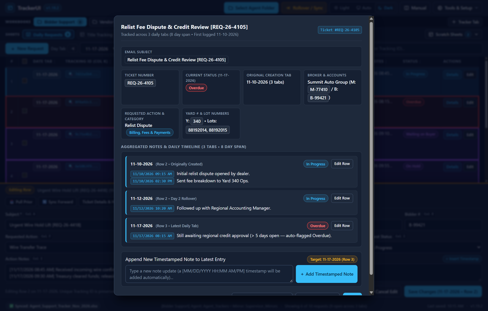

### How to Open & Use Ticket Details
- Click **`Details`** on any row, click **`[+] Expand`** inside Action Notes, or click **`Ticket Details & History`** in the Bottom Dock header.
- View **Email Subject**, **Ticket #**, **Master / Bidder**, and **Yard / Lot #** complete with **Split-Pill Copy Buttons**, **Parent Category** tag, and total days tracked.
- Read every daily instance ordered oldest → newest with `[MM/DD/YYYY HH:MM AM/PM]` timestamps parsed into clean chips, or click **`Edit Row`** to load any specific day's entry.
- Type into **`Append New Timestamped Note to Latest Entry`** and click **`＋ Add Timestamped Note`** to timestamp and save straight to the latest daily tab.

---

## 9. Searching, Sorting, Like-Item Filtering, Batch Actions & Row Copy/Paste

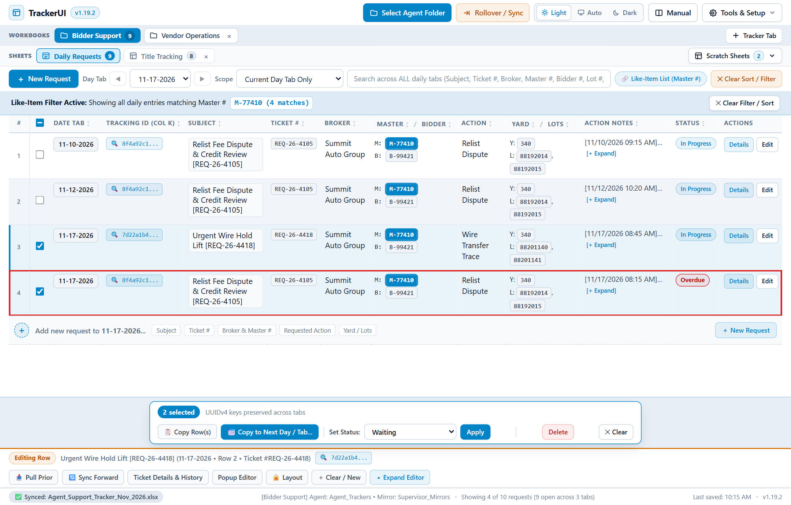

1. **Automatic Global Search**: Typing in the Controls search bar automatically searches **every `MM-DD-YYYY` tab** across all indexed columns (`Searching All Tabs`), then returns to your chosen **`Scope`** (`Current Day Tab Only` / `All Daily Tabs`) when cleared.
2. **Column & Sub-Column Sorting**: Click any column header to toggle ascending (`↑`) / descending (`↓`) sort; click **`Master`** vs. **`Bidder`** or **`Yard`** vs. **`Lots`** individually to sort by that sub-field.
3. **1-Click Like-Item Filtering**: Click any **`🔍 Tracking ID`**, **`Ticket #`**, **`Broker`**, **`Master #`**, **`Bidder #`**, **`Action`**, **`Yard #`**, **`Lot #`**, or **`Status`** chip to filter the entire workbook to matching rows. Click **`✕ Clear Filter / Sort`** to reset.
4. **Floating Batch Action Bar**: Check row boxes on the left to display the bottom Batch Bar (`X selected`):
   - **Batch Status Update**: Pick any status (`Pending`, `In Progress`, `Waiting`, `Waiting on Buyer`, `On Hold`, `Overdue`, `Escalated`, `Complete`) and click **`Apply`** (optionally syncing newer tabs too).
   - **Batch Delete**: Click **`Delete`** (or use **`Batch Delete Requests Mode`** in Tools & Setup) to confirm and remove rows cleanly.

### Manual Row Copy & Paste Across Daily Tabs (Great for Status-Free Trackers!)

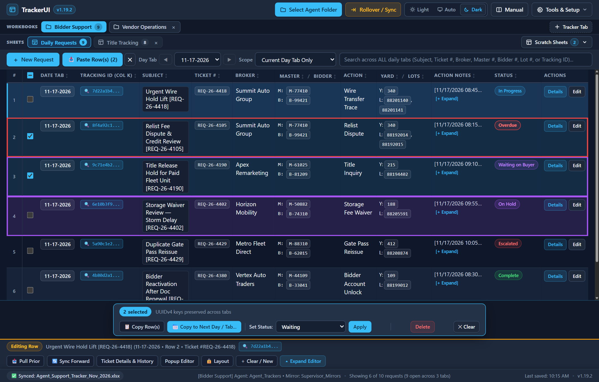

Even on secondary department workbooks that don't use a Status column or automated rollover:
- **Direct 1-Step Copy**: Check 1+ rows → click **`📅 Copy to Next Day / Tab...`** in the Batch Bar → confirm target `MM-DD-YYYY` date (creates the tab automatically from `template` if needed) to copy all fields and preserve hidden Column K Tracking IDs.
- **Two-Step Copy & Paste**: Check 1+ rows → click **`📋 Copy Row(s)`** (or press `Ctrl+C`) → switch to any `MM-DD-YYYY` tab → click **`📥 Paste Row(s) (N)`** in the top Controls bar (or press `Ctrl+V`).

---

## 10. Smart Daily Rollover, Overdue Aging & Carryover Engine

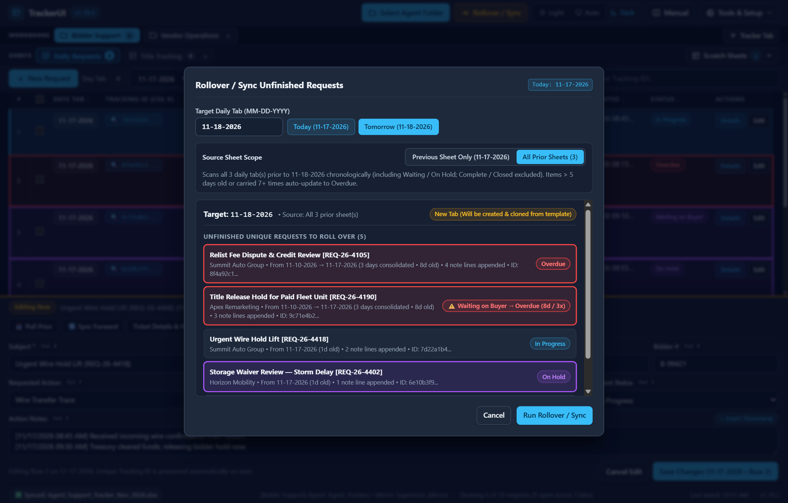

Click **`Rollover / Sync`** in the top header (or **`⚙️ Tools & Setup ▾` → `Rollover from Previous Sheet...`**) at the start of a new shift:

1. **Target Daily Tab (`MM-DD-YYYY`)**: Pick a 1-click preset (**`Today`**, **`Tomorrow`**, **`Latest Tab`**) or type a custom date. Missing tabs are automatically created from `template` and placed in chronological left-to-right order.
2. **Source Sheet Scope**: Choose **`Previous Sheet Only`** or **`All Prior Sheets`** (evaluates prior tabs oldest → newest).
3. **Waiting / On Hold Preservation & Smart Overdue Aging**:
   - Unfinished active requests—including **`Waiting`**, **`Waiting on Buyer`**, and **`On Hold`**—are explicitly preserved in **purple cards** and never dropped.
   - Any active unfinished item that is **more than 5 days old** (`> 5d`) or has been **carried over 7+ times** automatically promotes to **`Overdue`** (`red outline + red background tint`) with an aging badge (e.g., `⚠️ Waiting on Buyer → Overdue (8d / 3x)`).
4. **Idempotent Merge & Completed Override**: Existing rows on the target tab are never duplicated (only newer timestamped notes are appended), and any item previously marked `Complete` on a later sheet appears in a collapsible override section if you choose to reopen it.

---

## 11. Workbook Scratch Sheets (Cell Types, Fill Handle, Copy + `Enter` & `Auto-Filter Lists`)

Any Excel tab outside `MM-DD-YYYY` daily sheets and reserved reference sheets (`template`, `validation lists`, `Master Accounts`) opens automatically as a full editable **Scratch Sheet** under the **`Scratch Sheets ▾`** menu.

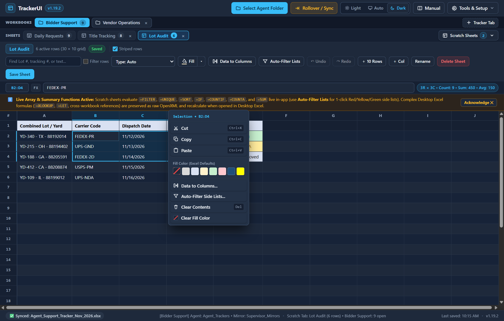

### 1. Navigation, Inline Editing & Copy + `Enter` Paste
- **Single-Click & Type / Double-Click (`F2`)**: Click a cell and start typing to replace, or press `F2` / double-click to edit existing text/formulas in place. Populated Row 1 cells are styled cleanly as headers inside the app.
- **Range Selection & Stats**: Drag across cells (or `Shift + Arrow Keys`), or click column letters / row numbers to highlight full columns/rows. Highlighting 2+ cells displays **`Count`**, **`Sum`**, and **`Avg`** automatically in the right corner of the Formula Bar.
- **Copy + `Enter` to Paste vs. `Ctrl+V`**:
  - Press **`Ctrl+C`** on a cell or range, move to any empty or target cell, and press **`Enter`** to paste and immediately clear the dashed copy marquee (standard Excel workflow!).
  - Press **`Ctrl+V`** if you want to paste and keep the copy marquee active for repeated pasting.
  - Both internal Scratch copy and Desktop Excel clipboard exchange preserve **cell fill colors**, **bold headers**, **font colors**, **borders**, and **auto-shifted relative formulas** (producing clean HTML tables when pasted into Outlook/Gmail/Teams).

### 2. Cell Data Types (`Type:`) & Corner Fill Handle Square (Auto-Increment)
- **Cell Format / Data Type Selector (`Type:`)**: Select cells or an entire column and set its OpenXML `numFmt`:
  - **`Type: Auto`** — Auto-detects dates and safe `<= 10`-digit numbers while protecting `11+`-digit tracking IDs and leading zeros as text.
  - **`Type: Text (@)`** — Strictly locks Lot numbers, Buyer codes, and long carrier tracking numbers (`1Z999...`, `940011...`) as exact text strings that **never auto-increment** or turn into scientific notation.
  - **`Type: Date (MM/DD/YYYY)`** — Parses flexible dates (`11-17-26`, `11/17/2026`, `2026-11-17`), displays `MM/DD/YYYY`, and increments by day when filled.
  - **`Type: Number (123)`** & **`Type: Currency ($)`** — Formats numbers and increments series cleanly.
- **Corner Fill Handle Square**: Hover the bottom-right corner of the active selection until the blue **corner square** appears:
  - **Drag** down, up, left, or right to copy text/formulas/styles—or automatically extrapolate **Dates** (`+1 day`) and **Numbers** (`+1`, or by the linear step across 2+ selected source cells!).
  - **Double-click** the corner square to fill down automatically alongside adjacent populated columns.
  - Hold **`Ctrl`** while dragging (or apply **`Type: Text (@)`**) to copy values strictly without incrementing.

### 3. Live `Auto-Filter Side Lists` (Red / Yellow / Green Title Tracking Workflow)

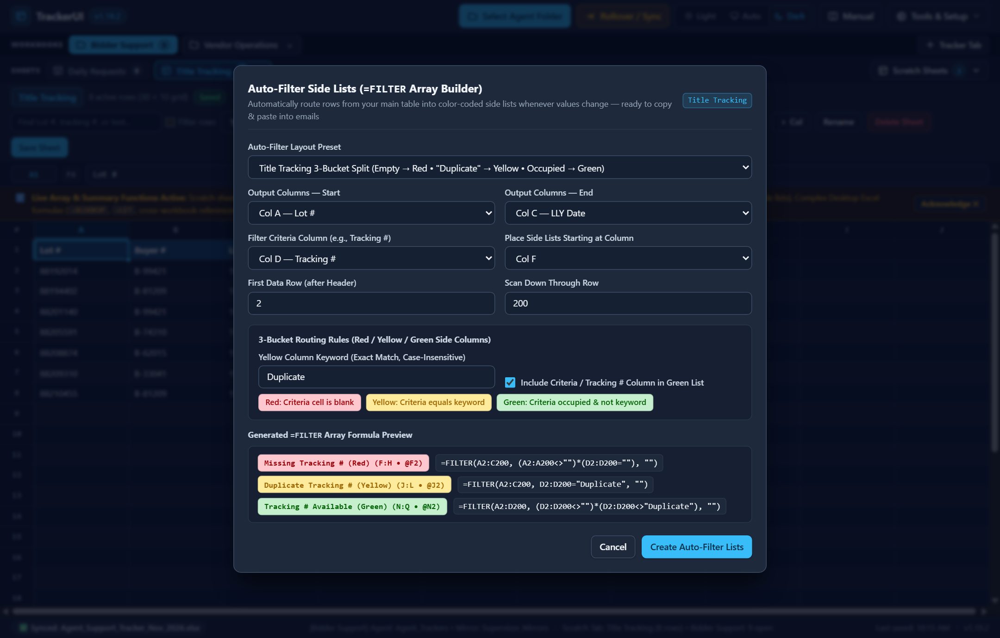

Designed specifically for workflows like **Title Mailing & LLY Tracking**, click **`Auto-Filter Lists`** in the Scratch toolbar (or right-click any cell → **`Auto-Filter Side Lists...`**, or choose the starter template under **`+ Create New Scratch Sheet...`**):
1. Choose your source **Output Columns** (for example, `Col A — Lot #` through `Col C — LLY Date`) and **Filter Criteria Column** (for example, `Col D — Tracking #`).
2. Choose **Place Side Lists Starting at Column** (e.g., `Col F`) and verify your Red / Yellow (`"Duplicate"`) / Green settings in the live **Generated `=FILTER` Array Formula Preview**.
3. Click **`Create Auto-Filter Lists`**: TrackerUI generates three color-coded side lists powered by **live `=FILTER` formulas**:
   - **Red List (No Tracking #)**: Lots where the criteria cell is still blank.
   - **Yellow List (`"Duplicate"`)**: Lots marked `"Duplicate"` (case-insensitive exact match).
   - **Green List (Available)**: Lots with an occupied tracking number (optionally including `Col D — Tracking #`).

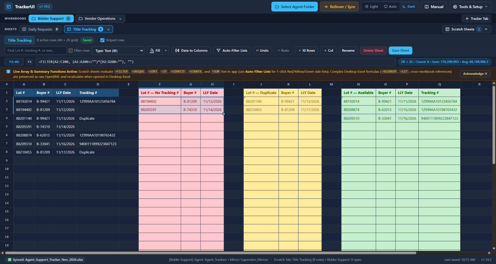

As soon as you type a tracking number or `"Duplicate"` in Column D, all three colored side lists **update and re-spill instantly in-app**—just drag across any Red/Yellow/Green list and press `Ctrl+C` (then `Ctrl+V` in Outlook/Gmail) to send crisp color-coded status tables to buyers!

### 4. Excel Default Fill Colors, Striped Rows & `Data to Columns`
- **Fill Color (`Fill ▾` & Right-Click Swatches)**: Apply Excel-native pastel headers, status tints (`Excel Good`, `Excel Neutral`, `Excel Bad`), or bold header fills saved directly into `.xlsx`.
- **`Striped rows`**: Visual-only alternating shading inside TrackerUI (never written to `.xlsx`).
- **`Data to Columns`**: Select delimited cells (e.g., `YD-340 - TX - 88192014`), click **`Data to Columns`**, check your delimiters (`Comma`, `Tab`, `Semicolon`, `Pipe`, `Hyphen`, `Space`, or `Other`), inspect the live preview, and split cleanly across columns (100% undoable with `Ctrl+Z`).

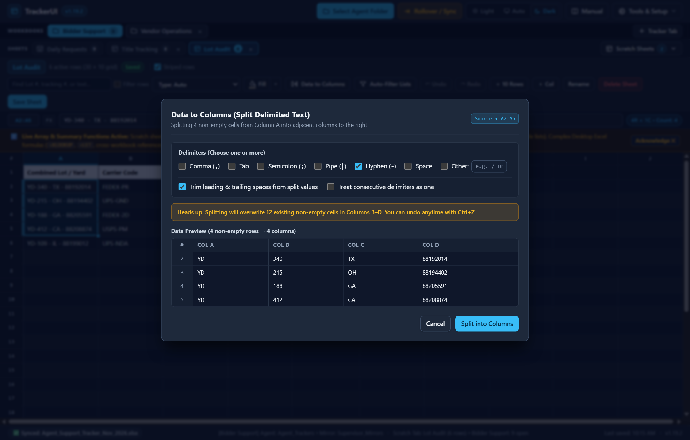

---

## 12. Scratch Sheet Excel Functions, Formula Syntax & Dynamic Array Reference

TrackerUI includes a live in-app **Scratch Sheet Formula & Dynamic Array Spill Engine** (`fx`). Formulas execute immediately as cells change and save as real OpenXML `<f>` formulas compatible with Desktop Excel.

> [!NOTE]
> Complex Desktop Excel-only formulas (such as `=XLOOKUP`, `=LET`, `=LAMBDA`, or external workbook links) remain safely preserved inside the `.xlsx` archive and recalculate when opened in Desktop Excel. You can dismiss the blue formula notice strip permanently by clicking **`Acknowledge ✕`**.

### A. Supported Dynamic Array, Logical, Math & Text Functions

| Category | Function & Syntax | What It Does in TrackerUI |
| :--- | :--- | :--- |
| **Dynamic Arrays** | `=FILTER(array, include, [if_empty])` | Filters rows (or single-row columns) where `include` evaluates true and **automatically spills** matches downward/rightward while skipping completely blank source rows. Returns `if_empty` (or `#CALC!`) if nothing matches. |
| **Dynamic Arrays** | `=UNIQUE(array)` | Extracts deduplicated rows/values from a range (case-insensitive comparison) and spills the unique list. |
| **Dynamic Arrays** | `=SORT(array, [sort_index], [sort_order])` | Sorts a range or nested `=FILTER(...)` result by 1-based column `sort_index` (default `1`) and direction (`1` = ascending, `-1` = descending), supporting Dates, Numbers, and natural text order. |
| **Conditional / Logic** | `=IF(condition, value_if_true, [value_if_false])` | Evaluates scalar conditions or broadcasts across array ranges (`=IF(D2="", "Missing", "Ready")`). |
| **Conditional / Logic** | `=AND(logical1, [logical2], ...)` | Returns `TRUE` if every value/expression in all arguments is true. |
| **Conditional / Logic** | `=OR(logical1, [logical2], ...)` | Returns `TRUE` if at least one value/expression evaluates true. |
| **Conditional / Logic** | `=NOT(logical)` | Negates a single boolean or broadcasts negation element-by-element across a range. |
| **Information** | `=ISBLANK(value)` / `=ISEMPTY(value)` | Returns `TRUE` for blank/empty cells (supports single cells and range broadcasting). |
| **Information** | `=ISNUMBER(value)` | Returns `TRUE` for numeric values (supports array broadcasting). |
| **Information** | `=ISTEXT(value)` | Returns `TRUE` for non-empty text values (supports array broadcasting). |
| **Counting** | `=COUNTIF(range, criteria)` | Counts matching cells using exact match (`"Duplicate"`), comparison strings (`">100"`, `"<>Duplicate"`), or wildcards (`"*FEDEX*"`, `"B-?????"`). |
| **Counting** | `=COUNTA(value1, [value2], ...)` | Counts all non-empty cells in one or more ranges or spilled arrays. |
| **Counting** | `=COUNTBLANK(range)` | Counts all blank cells across one or more ranges. |
| **Aggregation Math** | `=SUM(number1, [number2], ...)` | Sums all numeric values in the specified cells/ranges. |
| **Aggregation Math** | `=AVERAGE(number1, [number2], ...)` | Computes the arithmetic mean of numeric cells (`#DIV/0!` if none). |
| **Aggregation Math** | `=MIN(number1, [number2], ...)` | Returns the minimum numeric value (`0` if range has no numbers). |
| **Aggregation Math** | `=MAX(number1, [number2], ...)` | Returns the maximum numeric value (`0` if range has no numbers). |
| **Text Functions** | `=TRIM(text)` | Trims leading/trailing spaces and collapses internal whitespace runs (array-capable). |
| **Text Functions** | `=UPPER(text)` / `=LOWER(text)` | Converts text to uppercase or lowercase (array-capable). |
| **Text Functions** | `=LEN(text)` | Returns character length of text (array-capable). |
| **Text Functions** | `=LEFT(text, [num_chars])` / `=RIGHT(text, [num_chars])` | Extracts `num_chars` (default `1`) from the start or end of a string (array-capable). |
| **Text Functions** | `=MID(text, start_num, num_chars)` | Extracts `num_chars` starting at 1-based position `start_num` (array-capable). |
| **Text Functions** | `=SEARCH(find_text, within_text, [start_num])` | Case-insensitive 1-based position lookup (`#VALUE!` if not found; array-capable). |
| **Text Functions** | `=FIND(find_text, within_text, [start_num])` | Case-sensitive 1-based position lookup (`#VALUE!` if not found; array-capable). |
| **Date Functions** | `=TODAY()` | Returns today's current date formatted as `MM/DD/YYYY` (supports date sorting & `<` / `>` date comparisons). |

---

### B. Operators, Compound `=FILTER` Boolean Logic & Reference Syntax

| Syntax Feature | Supported Forms | Example & Behavior |
| :--- | :--- | :--- |
| **Comparison Operators** | `=`, `<>`, `!=`, `<`, `<=`, `>`, `>=` | Case-insensitive text matching (`D2:D200="duplicate"`), chronological date comparisons (`C2:C200<TODAY()`), and numeric inequalities (`B2:B200>=100`). |
| **Math & Text Concatenation** | `+`, `-`, `*`, `/`, `&` | Arithmetic operations and string concatenation (`A2 & " — " & B2`). Divides by zero cleanly as `#DIV/0!`. |
| **Compound Array AND (`*`)** | `(Cond1)*(Cond2)` | Multiply boolean criteria ranges inside `=FILTER` to require **both** conditions on the same row (`1 * 1 = 1` true). |
| **Compound Array OR (`+`)** | `(Cond1)+(Cond2)` | Add boolean criteria ranges inside `=FILTER` to match **either** condition on the same row (`1 + 0 = 1` true). |
| **Relative vs. Absolute (`$`)** | `A2`, `$A$2`, `$A2`, `A$2` | Copying & pasting (`Ctrl+C` → `Enter` / `Ctrl+V`) or dragging the Fill Handle automatically shifts relative coordinates (`A2` → `A3`) while locking `$`-prefixed columns or rows (`$A$2:$D$200`). |
| **Cross-Sheet References** | `Sheet1!A2:B50` or `'Title Tracking'!A2:D200` | Read single cells or ranges from any other sheet inside the active workbook (use single quotes around sheet names containing spaces). |
| **Boolean Literals & Escaped Quotes** | `TRUE`, `FALSE`, `""` | Standard Excel booleans and empty string `""` checks; double quotes inside strings escape as `""`. |

### C. Copy-Ready Real-World Formula Recipes

- **Red Bucket (Blank Tracking #, non-empty Lot rows)**:
  ```excel
  =FILTER(A2:C200, (A2:A200<>"")*(D2:D200=""), "No missing tracking")
  ```
- **Yellow Bucket (`"Duplicate"` Titles)**:
  ```excel
  =FILTER(A2:C200, (A2:A200<>"")*(D2:D200="Duplicate"), "None")
  ```
- **Green Bucket (Tracking Occupied & Not Duplicate, Sorted by LLY Date Ascending)**:
  ```excel
  =SORT(FILTER(A2:D200, (A2:A200<>"")*(D2:D200<>"")*(D2:D200<>"Duplicate"), "None"), 3, 1)
  ```
- **Quick Buyer Summary Counts (Empty vs. Duplicate vs. Shipped)**:
  ```excel
  ="Missing: " & COUNTBLANK(D2:D50) & " | Dupes: " & COUNTIF(D2:D50, "Duplicate") & " | Shipped: " & COUNTA(F2:F50)
  ```
- **Unique Active Buyers List**:
  ```excel
  =SORT(UNIQUE(FILTER(B2:B200, A2:A200<>"")))
  ```

### D. In-App Formula Error Codes & Spill Indicators
- **Blue Top-Left Corner Triangle**: Indicates a dynamic array formula anchor (`=FILTER`, `=UNIQUE`, `=SORT`) whose spilled cells below/right show subtle array shading and tooltip provenance (`Spilled from F2`).
- **`#SPILL!`**: One or more destination cells needed by an array spill already contain manual values—clear the blocking cells and the formula immediately re-spills!
- **`#CALC!`**: A `=FILTER(...)` matched zero rows and had no `[if_empty]` fallback argument (pass `""` or `"None"` as the 3rd argument to avoid `#CALC!`).
- **`#DIV/0!`** / **`#VALUE!`** / **`#REF!`** / **`#NAME?`** / **`#CIRC!`**: Standard Excel error codes for division by zero, bad arguments, missing sheet/cell references, unknown function names, and circular reference protection.

---

## 13. Supervisor Tools (`View-Only Inspector` & `Multi-Workbook Master Rollup`)

TrackerUI includes two dedicated supervisor tools inside **`⚙️ Tools & Setup ▾`** under **Directories & Mirroring**:

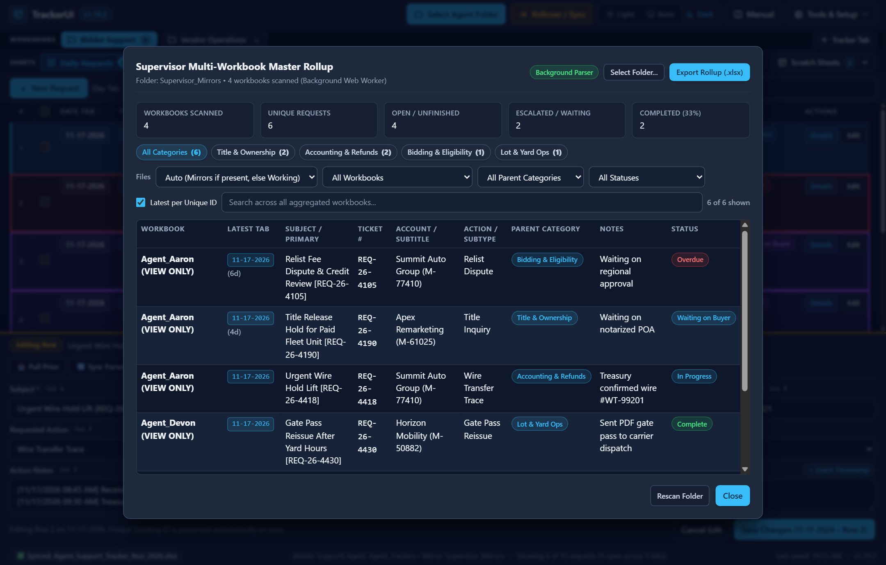

### 1. Supervisor Multi-Workbook Master Rollup (`Supervisor Multi-Workbook Rollup...`)
- **Background Web Worker Scanning**: Parses every `.xlsx` or `(VIEW ONLY).xlsx` file in a team folder simultaneously without freezing your browser tab.
- **KPI Summary Cards**: Displays **Workbooks Scanned**, **Unique Requests** (deduplicated across daily rollover tabs by Tracking ID), **Open / Unfinished**, **Escalated / Waiting**, and **Completed (%)**.
- **Subtype → Parent Category Pipeline**: Groups granular actions into executive categories (*Bidding & Eligibility*, *Accounting & Refunds*, *Title & Ownership*, *Lot & Yard Ops*) with 1-click category filter pills.
- **Standalone Excel Export**: Click **`Export Rollup (.xlsx)`** to download `Master_Tracker_Rollup_MM-DD-YYYY.xlsx` with **Master Rollup** and **Category Summary** worksheets.

### 2. View-Only Mirror Inspector (`Open View-Only Mirror...`)

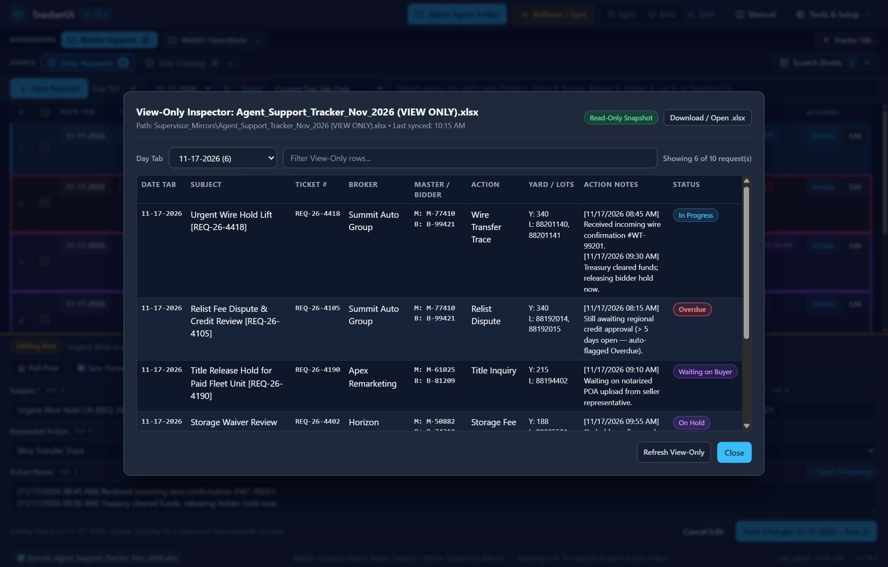

- Reads `<Workbook Name> (VIEW ONLY).xlsx` straight into memory as a non-locking `ArrayBuffer`, complete with Day Tab filtering, search, sync status badge, and **`Download / Open .xlsx`**.

---

## 14. Backup, Portable `.json` Config & PWA Updates

- **Exporting & Importing Configuration (`.json`)**: Inside **`⚙️ Tools & Setup ▾`**, click **`Export Workspace Config (.json)`** to back up your Department Tracker Profiles, custom column mappings, **`📋 Copy`** column settings, 12-column form layouts, and UI preferences. Use **`Import Workspace Config (.json)...`** on any workstation to restore your setup immediately.
- **Checking for Updates & Clearing Cache**: Click the **`v1.19.2`** badge next to the TrackerUI logo (or **`⚙️ Tools & Setup ▾` → `Check for Updates & Clear Cache`**) to clear old Service Worker caches and load the latest release. When background updates arrive, an **Update Ready** banner appears with a **`Reload Now`** button.

---

## 15. Quick Reference: Where to Click & Keyboard Shortcuts

### Where to Click Cheat Sheet

| Goal / Task | Where to Click |
| :--- | :--- |
| **Connect or switch Excel folder** | Top Header → **`Select Agent Folder`** / **`Switch Folder`** (or **`Tools & Setup ▾` → `Tracker Workbooks Folder...`**) |
| **Add another department's tracker** | `Workbooks` bar (far right) → **`+ Tracker Tab`** |
| **Rename a workbook tab** | **Double-click** the workbook tab in the `Workbooks` bar |
| **Take over locked session in current tab** | Red Standby Banner → **`⚡ Take Over Active Session Here`** |
| **Retry save when Excel locked a file** | Bottom Status Bar → **`💾 Retry Primary Save`** or **`Retry Mirror Sync`** |
| **Switch Daily Requests / Scratch Sheets** | `Sheets` bar → Click **`Daily Requests`** or any open scratch tab (`Scratch Sheets ▾` on right) |
| **Filter table or copy field to clipboard** | Table cell split-pill → **Left text filters** • **Right copy icon copies to clipboard** |
| **Extract `[XXXX-XX-XXXX]` ticket from Subject** | Bottom Dock / Modal → **`🎯 Grab Ticket`** above Ticket Number |
| **Pull blank fields from prior daily tab** | Bottom Dock / Modal Header → **`📥 Pull Prior`** |
| **Push updates forward to newer tabs** | Bottom Dock Header or Ticket Details → **`🔄 Sync Forward`** |
| **Adjust form field widths, order, or rows** | Bottom Dock Header → **`🔒 Layout`** (`◀ ▶`, `− +`, `↕− ↕+`, drag borders) |
| **Bulk copy/paste or update row statuses** | Check left-hand row checkboxes → **`📋 Copy Row(s)`** / **`📅 Copy to Next Day / Tab...`** / **`Set Status` → `Apply`** |
| **Roll unfinished requests to next day** | Top Header → **`Rollover / Sync`** |
| **Build Red/Yellow/Green `=FILTER` side lists** | Scratch Toolbar (or Right-Click) → **`Auto-Filter Lists`** |
| **Set Text/Date/Number/Currency type** | Scratch Toolbar → **`Type:`** dropdown (`Type: Text (@)` locks tracking #s against auto-increment) |
| **Aggregate multiple agent workbooks** | **`⚙️ Tools & Setup ▾` → `Supervisor Multi-Workbook Rollup...`** |

### Keyboard Shortcuts (Scratch Sheets, Daily Table & Global)

| Shortcut | Action |
| :--- | :--- |
| `Arrow Keys` / `Tab` / `Shift+Tab` | Move active cell selection across the Scratch Sheet grid |
| `Shift + Arrow Keys` | Expand multi-cell range selection on Scratch Sheets |
| `Enter` / `Shift+Enter` | Commit cell edit and move down / up (or **Paste immediately** if Copy Marquee is active!) |
| `Ctrl + C` then `Enter` | Paste copied Scratch cell/range at destination and clear copy marquee |
| `Ctrl + C` / `Ctrl + X` / `Ctrl + V` | Copy / Cut / Paste Scratch cells (preserving fills, bold headers, HTML email tables & shifted formulas) or copy/paste checked Daily Request rows |
| `Drag Corner Square` | Fill cells across rows/columns (auto-increments Dates & Numbers `<= 10` digits; hold **`Ctrl`** to copy without incrementing) |
| `Double-Click Corner Square` | Auto-fill formula or value down alongside adjacent populated columns |
| `F2` or `Double-Click Cell` | Edit inside active Scratch Sheet cell without overwriting existing text |
| `Delete` / `Backspace` | Clear contents of all selected Scratch Sheet cells |
| `Ctrl + Z` / `Ctrl + Y` (or `Ctrl+Shift+Z`) | Undo / Redo cell values, fill colors, data types & `Data to Columns` splits (up to 50 steps) |
| `Ctrl + S` | Immediately flush and save pending Scratch Sheet edits to `.xlsx` & `(VIEW ONLY)` mirror |
| `Escape` | Cancel inline cell edit or close active modal / context menu / popover |
