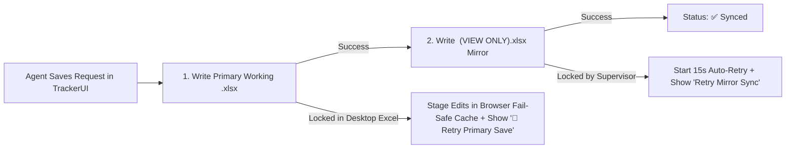

# TrackerUI (`v1.17.3`) — Complete User Manual & Reference Guide

Welcome to the official **TrackerUI User Manual**. TrackerUI is a standalone, zero-build Progressive Web App (PWA) purpose-built for managing daily support requests, multi-department Excel trackers, scratch worksheets, and supervisor mirror workbooks directly on your local drive or OneDrive folder.

---

## 📑 Table of Contents

1. [Browser Requirements & Getting Started](#1-browser-requirements--getting-started)
2. [Workspace Layout & Navigation Hierarchy](#2-workspace-layout--navigation-hierarchy)
3. [Connecting Folders, Dual-Write Mirroring & Fail-Safe Saving](#3-connecting-folders-dual-write-mirroring--fail-safe-saving)
4. [The Tools & Setup Menu (`⚙️ Tools & Setup ▾`)](#4-the-tools--setup-menu-️-tools--setup-)
5. [Daily Request Management (Creating & Editing Requests)](#5-daily-request-management-creating--editing-requests)
6. [Time-Saving Editor Power Tools (`🎯 Grab Ticket`, `📥 Pull Prior`, `🔄 Sync Forward`)](#6-time-saving-editor-power-tools--grab-ticket--pull-prior--sync-forward)
7. [Multi-Department Trackers, Custom Schemas & Lockable Form Layout](#7-multi-department-trackers-custom-schemas--lockable-form-layout)
8. [Ticket Details & Multi-Day Aggregated Timeline](#8-ticket-details--multi-day-aggregated-timeline)
9. [Searching, Sorting, Like-Item Filtering & Batch Actions](#9-searching-sorting-like-item-filtering--batch-actions)
10. [Smart Daily Rollover & Carryover Engine](#10-smart-daily-rollover--carryover-engine)
11. [Workbook Scratch Sheets (Colors, Context Menu & `Data to Columns`)](#11-workbook-scratch-sheets-colors-context-menu--data-to-columns)
12. [Supervisor Tools (`View-Only Inspector` & `Multi-Workbook Master Rollup`)](#12-supervisor-tools-view-only-inspector--multi-workbook-master-rollup)
13. [Backup, Portable `.json` Config & PWA Updates](#13-backup-portable-json-config--pwa-updates)
14. [Quick Reference: Where to Click & Keyboard Shortcuts](#14-quick-reference-where-to-click--keyboard-shortcuts)

---

## 1. Browser Requirements & Getting Started

> [!IMPORTANT]
> **Use Google Chrome in Desktop Mode:** TrackerUI relies on the native Chromium **File System Access API** (`window.showDirectoryPicker`) to read and write `.xlsx` files directly in your local or OneDrive folders. If you open the app in a non-Chrome browser (Firefox, Safari, Edge, Brave) or in a mobile viewport mode, a native browser alert will notify you that TrackerUI is designed specifically for **Google Chrome in Desktop Mode**.

### First-Time Startup Steps
1. Open TrackerUI in **Desktop Google Chrome**.
2. In the top header bar, click the blue **`Select Agent Folder`** button.
3. Choose the folder on your computer (or OneDrive) that contains your monthly `.xlsx` tracker workbooks (for example, `Agent_Trackers\`).
4. When Chrome prompts **"Let site view files?"** and **"Save changes to original files?"**, click **View files** / **Allow**.
5. TrackerUI automatically remembers your folder handles and active workbook so future sessions reconnect in **1 click** (or automatically when **`Auto-Reconnect`** is checked).

---

## 2. Workspace Layout & Navigation Hierarchy

TrackerUI organizes your workspace into a clear **top-to-bottom parent-child hierarchy** so you always know which department workbook and which worksheet you are viewing:

### Visual Anatomy (Top to Bottom)

| Zone | UI Location | Purpose & Where to Click |
| :--- | :--- | :--- |
| **1. Top Header Bar** | Very top of window | Switch monthly `.xlsx` files in the **`Workbook`** dropdown, click **`Switch Folder`** (or **`Reconnect Folder`**), launch **`Rollover / Sync`**, toggle **`Light` / `Auto` / `Dark`** theme, or open **`⚙️ Tools & Setup ▾`**. |
| **2. `Workbooks` Bar** | Level 1 bar (above File Paths) | Switch between separate department tracker profiles (e.g., **`Bidder Support`** vs. **`Vendor Operations`**). The active workbook tab has a solid blue background. Click **`+ Tracker Tab`** on the right to add another department tracker. |
| **3. File Paths Strip** | Directly below `Workbooks` bar | Displays live paths for **`Tracker:`** (your working `.xlsx`), **`View-Only:`** (the supervisor mirror copy), and **`Templates:`**, plus the **`Auto-Reconnect`** toggle on the far right. |
| **4. `Sheets` Bar** | Level 2 bar (below File Paths) | Switches between views **inside** the active workbook: **`Daily Requests`** (all `MM-DD-YYYY` tabs) and any open **`Scratch Sheets`** (e.g., `Title Tracking`, `Lot Audit`). Use **`Scratch Sheets ▾`** on the right to open or create scratch sheets. |
| **5. Controls & Search Bar** | Above the main table | Click **`+ New Request`**, step between dates with **`◀` / `▶`** around the **`Day Tab`** dropdown, switch **`Scope`** (`Current Day Tab Only` vs. `All Daily Tabs`), or type in the **Global Search Box**. |
| **6. Quick Date Pill Strip** | Below the Controls bar | Click any `MM-DD-YYYY` pill (ordered oldest left → newest right) to jump directly to that day's sheet. Each pill displays its total request count. |
| **7. Main Requests Table** | Center of workspace | Displays all requests for the active view. Click any row to load it into the **Bottom Editor Dock**; double-click **`Edit`** to open the popup modal. |
| **8. Bottom Editor Dock** | Pinned above Status Bar | Create or edit requests without covering the table. Click the header bar or **`▾ Collapse`** to fold/expand the dock at any time. |
| **9. Status Bar** | Bottom edge of window | Shows save/sync status (`Synced: ...`), manual retry buttons if a file is locked in Excel, active folder summary, open request statistics, and app version (`v1.17.3`). |

---

## 3. Connecting Folders, Dual-Write Mirroring & Fail-Safe Saving

TrackerUI uses a **Dual-Write Architecture** to eliminate file locking conflicts between agents and supervisors:

### How Dual-Write & Fail-Safe Protection Work
1. **Automatic File Filtering**: When scanning your Agent Folder, TrackerUI automatically ignores temporary Excel lock files (`~$*`) and mirror copies (`*(VIEW ONLY).xlsx`) so you never accidentally edit a read-only file.
2. **Supervisor `(VIEW ONLY).xlsx` Mirror**: Every save automatically writes an identical `<Workbook Name> (VIEW ONLY).xlsx` file into your configured **Supervisor Folder** (or the same folder if no separate Supervisor Folder is set).
3. **If a Supervisor Has the Mirror Open in Excel**: Your primary save still succeeds immediately! The status bar shows a warning pill, starts a **15-second background auto-retry countdown**, and displays a manual **`Retry Mirror Sync`** button on the bottom-left status bar.
4. **If You Have Your Own Working File Open in Desktop Excel**: If Desktop Excel locks your primary `.xlsx` file during a save, TrackerUI stages your exact workbook buffer inside IndexedDB browser storage so **zero work is lost**. Close the file in Desktop Excel and click **`💾 Retry Primary Save`** in the bottom-left status bar (or reload the app to be prompted to restore your staged edits).

---

## 4. The Tools & Setup Menu (`⚙️ Tools & Setup ▾`)

Click **`⚙️ Tools & Setup ▾`** in the top-right corner of the header to access all workspace configuration, workbook creation, schema mapping, and sheet management tools:

### Complete Menu Breakdown

#### 1. Appearance & Display
- **`Light` / `Auto` / `Dark`**: Switch color themes (also accessible directly in the top header bar).
- **`Text Size` (`A−` / Slider / `A+`)**: Scale all UI text, table cells, and inputs proportionally from **85% to 125%**. Click **`Reset`** next to the percentage pill to return to `100%`.

#### 2. Directories & Mirroring
- **`Tracker Folder`**: Change your primary working `.xlsx` directory (or click **`Clear`** to forget the saved handle).
- **`Supervisor Folder`**: Choose a separate shared folder where `(VIEW ONLY).xlsx` mirror copies are written. Click **`Reset`** to revert back to saving mirrors in the Agent Folder.
- **`Templates Folder`**: Point TrackerUI to a folder of master `.xlsx` templates. When creating a new monthly workbook, you can clone directly from any template in this folder (preserving all custom Excel validations, styles, and reference sheets).
- **`Open View-Only Mirror...`**: Opens the read-only in-app inspector for the `(VIEW ONLY).xlsx` mirror copy.
- **`Supervisor Multi-Workbook Rollup...`**: Launches the cross-workbook aggregation and category dashboard for supervisors.
- **`Write (VIEW ONLY).xlsx Mirror Copy`**: Toggle whether the current workbook tab generates a `(VIEW ONLY).xlsx` mirror file on save.
- **`Auto-Reconnect Folders on Startup`**: Toggle automatic startup folder reconnection.

#### 3. Workbook & Schema
- **`Create New Monthly Workbook...`**: Creates a brand-new `.xlsx` file in your Agent Folder—either cloned from a file in your **Templates Folder** or bootstrapped in memory with standard `template`, `validation lists`, and today's `MM-DD-YYYY` tab.
- **`Bootstrap / Repair Workbook Schema`**: Non-destructively repairs a blank or incomplete workbook by adding any missing reference sheets (`template`, `validation lists`) or today's `MM-DD-YYYY` tab without touching existing data.
- **`Configure Column Mapping...`**: Opens the dynamic column mapper to inspect or override how custom department headers map to Primary Subject, Ticket #, Notes, and Status.
- **`Add Department Tracker Tab...`**: Creates a new top-level workbook profile tab in the `Workbooks` bar.
- **`Rename Active Tracker Tab...`**: Renames the current workbook tab (or simply **double-click** any tab in the `Workbooks` bar).
- **`Create New Scratch Sheet...`**: Adds a new freeform spreadsheet tab inside the current Excel workbook.
- **`Use Mock Master Accounts (Dev Test)`**: Populates Broker / Master # / Bidder # auto-fill with sample test accounts when working without a `Master Accounts` sheet.

#### 4. Active Day Tab Management
- **`New Day Tab (Blank or Rollover)...`**: Prompts for a `MM-DD-YYYY` date and lets you create either a clean blank daily sheet (cloned from `template`) or immediately run rollover into that date.
- **`Rollover from Previous Sheet...`**: Opens the Rollover modal pre-set to carry unfinished items strictly from the immediately preceding `MM-DD-YYYY` tab.
- **`Rename Current Day Tab...`**: Renames the active `MM-DD-YYYY` worksheet.
- **`Delete Current Day Tab...`**: Deletes the active `MM-DD-YYYY` daily sheet after confirmation (reference sheets like `template`, `validation lists`, and `Master Accounts` are protected and cannot be deleted).

#### 5. Row Management, Config & Cache
- **`Batch Delete Requests Mode`**: Toggles checkbox selection mode with a confirmation banner to delete multiple rows at once.
- **`Export Workspace Config (.json)` / `Import Workspace Config (.json)...`**: Back up or restore your department tabs, custom column mappings, form field layouts, and preferences as a portable `.json` file.
- **`Check for Updates & Clear Cache`**: Forces the PWA Service Worker to clear cached assets and fetch the latest version from the server.

---

## 5. Daily Request Management (Creating & Editing Requests)

TrackerUI gives you two synchronized editors for working with requests: the **Docked Bottom Editor** (for rapid multitasking while reading the table) and the **Popup Modal Editor**.

### Where to Click
- **To Create a New Request**:
  - Click **`+ New Request`** on the left side of the Controls bar, **or**
  - Click **`+ Clear / New`** in the Bottom Editor Dock header if you are currently editing an existing row.
- **To Edit an Existing Request**:
  - **Single-click anywhere on a request row** in the table to load it into the **Bottom Editor Dock** (the active row highlights in blue and the dock badge changes to amber **`Editing Row`**).
  - Click the **`Edit`** button in the row's **Actions** column (or click **`Popup Editor`** in the dock header) if you prefer a centered modal dialog.
- **To Collapse or Expand the Bottom Dock**:
  - Click **`▾ Collapse`** on the far right of the dock header (or click the dock title area) to fold the editor down to a slim bar and maximize table space.

### Automatic Formatting & Auto-Fill Rules
1. **Bidirectional Master Account Auto-Fill**:
   - If your workbook includes a `Master Accounts` sheet (or Dev Mock Mode is enabled), typing or selecting a **Broker Name** (`Col C`) automatically fills **Master #** (`Col D`) and **Bidder #** (`Col E`).
   - Typing a known **Master #** (`Col D`) reverse-fills the **Broker Name** (`Col C`) and **Bidder #** (`Col E`).
2. **Automatic Uppercase Normalization**:
   - On save, `Ticket Number` (`Col B`), `Master #` (`Col D`), `Bidder #` (`Col E`), and `Yard #` (`Col G`) are automatically normalized to uppercase.
3. **Immutable Tracking ID (`Col K`)**:
   - Every new request is assigned a permanent 36-character UUIDv4 in hidden **Column K**. Editing a row's Subject, Ticket Number, or Broker **never** alters or breaks its Tracking ID.
4. **Inserting Timestamps**:
   - Click **`+ Insert Timestamp`** above the **Action Notes** box to insert a formatted `[MM/DD/YYYY HH:MM AM/PM]` prefix at the end of your notes.

---

## 6. Time-Saving Editor Power Tools (`🎯 Grab Ticket`, `📥 Pull Prior`, `🔄 Sync Forward`)

Located in the **Bottom Editor Dock** (and **Popup Editor**), these three workflow accelerators eliminate manual copy-pasting across tabs:

### 1. `🎯 Grab Ticket` (Extract Ticket # from Email Subject)
- **Where to Click**: Right above the **Ticket Number** input field (`🎯 Grab Ticket` pill).
- **What It Does**: Scans the **Subject** field for bracketed, hyphenated ticket numbers (such as `[REQ-24-8812]` or `[ABCD-12-3456]`), strips the brackets, normalizes to uppercase, and merges them into the **Ticket Number** box (`Col B`) comma-delimited without duplicates.

### 2. `📥 Pull Prior` (Sync Blank Fields from Earlier Daily Tabs)
- **Where to Click**: In the Bottom Editor Dock header (`📥 Pull Prior`) or Popup Modal header (`📥 Pull from Prior Tab`).
- **What It Does**: Looks backward across all older `MM-DD-YYYY` tabs in the workbook to find the most recent prior entry matching the current request (by Tracking ID, Ticket Number, Broker/Master/Lot identity, or Subject).
- **Non-Destructive Fill**: Automatically fills **only** the fields that are currently blank on your form, while comma-merging any newly discovered Ticket Numbers.

### 3. `🔄 Sync Forward` (Propagate Updates to Newer Rolled-Over Tabs)
- **Where to Click**: Appears in the Bottom Editor Dock header (`🔄 Sync Forward`) and inside the **Ticket Details** modal (`🔄 Sync Forward Across Tabs`) whenever you are viewing a request that exists on multiple daily tabs.
- **What It Does**: If you add a missing Ticket Number, Master #, Bidder #, or Lot # to an older tab (or latest tab), clicking **`🔄 Sync Forward`** scans all newer `MM-DD-YYYY` tabs where that request was rolled over, previews the exact non-destructive changes, and fills blank fields (plus comma-merges Ticket Numbers) across every forward tab in one save.

---

## 7. Multi-Department Trackers, Custom Schemas & Lockable Form Layout

If you support multiple departments that use different Excel tracker layouts (for example, an 8-column or 10-column department sheet with custom headers), TrackerUI handles them natively without hardcoding.

### Managing Multiple Workbook Tabs (`Workbooks` Bar)
- **Add a Department Tab**: Click **`+ Tracker Tab`** on the right end of the top **`Workbooks`** bar (or **`⚙️ Tools & Setup ▾` → `Add Department Tracker Tab...`**).
- **Independent Folders & Schemas**: Each tab in the `Workbooks` bar remembers its own **Agent Folder**, **Supervisor Folder**, active `.xlsx` file, and column schema.
- **Switch Workbooks**: Click any tab in the `Workbooks` bar (the active tab is highlighted with a solid blue fill).
- **Rename a Workbook Tab**: **Double-click** any tab in the `Workbooks` bar (or use **`Tools & Setup ▾` → `Rename Active Tracker Tab...`**).
- **Close/Remove a Workbook Tab**: Click the **`×`** button on any secondary workbook tab. (Removing a tab from the UI never deletes your Excel files on disk.)

### Customizing the 12-Column Form Layout (`🔒 Layout` → `🔓 Lock Layout`)
By default, the Bottom Editor Dock is **locked** (`🔒 Layout`) and automatically arranges custom department fields into a clean 12-column grid (placing wide `Notes` fields at the bottom). To customize field widths, order, or height:
1. Click **`🔒 Layout`** in the Bottom Editor Dock header. The button turns amber (**`🔓 Lock Layout`**) and each field displays compact adjustment controls.
2. **Reorder Fields (`◀` / `▶`)**: Click **`◀`** or **`▶`** in the top-left of any field card to move it earlier or later in the form. *(Note: Reordering fields in the form only changes their visual position in the app—your Excel column order `Col A`, `Col B`, etc. is strictly preserved on save!)*
3. **Adjust Field Width (`−` / `+` or Drag Right Edge)**: Click **`−`** or **`+`** (from `2/12` up to `12/12` full width), or drag the vertical resize handle on the right border of any field card.
4. **Adjust Notes Height (`↕−` / `↕+`)**: On `Notes` textarea fields, click **`↕−`** or **`↕+`** to set the height between `1r` and `6r` rows.
5. **Lock or Reset**: Click **`🔓 Lock Layout`** when finished to lock your layout in place (saved automatically per schema), or click **`↺ Reset Layout`** to restore the smart default grid.

### Configuring Column Roles (`Configure Column Mapping`)

When you open a custom department workbook, TrackerUI automatically inspects Row 1 headers and infers which column represents the **Primary Title**, **Status**, **Notes**, **Ticket #**, and **Secondary Account**.
- To inspect or override these mappings, click **`⚙️ Tools & Setup ▾` → `Configure Column Mapping...`** (or click the **`CUSTOM`** badge on the workbook tab).
- Choose which Row-1 column controls status badges/rollover, chronological notes merging, and `🎯 Grab Ticket` extraction, then click **`Save Column Mapping`**.

---

## 8. Ticket Details & Multi-Day Aggregated Timeline

Because unfinished requests roll forward from day to day while preserving their hidden **Column K Tracking ID**, TrackerUI can assemble the complete multi-day lifecycle of any request in a single view.

### Where to Click to Open Ticket Details
- Click the **`Details`** button in the **Actions** column of any row in the table, **or**
- Click **`[+] Expand`** inside any truncated **Action Notes** cell, **or**
- Click **`Ticket Details & History`** in the Bottom Editor Dock header while editing a row.

### What You Can Do Inside Ticket Details
1. **Review Multi-Day Metadata**: See the request's current status, original creation tab, total days tracked, associated Broker/Master/Bidder accounts, and automatically classified **Parent Category**.
2. **Read Chronological Daily Timeline**: View how the request progressed across every `MM-DD-YYYY` tab, with each `[MM/DD/YYYY HH:MM AM/PM]` note parsed into a clean timeline chip. Click **`Edit Row`** on any day card to jump straight to that specific day's entry.
3. **Append a New Timestamped Note Instantly**: Type an update in the **`Append New Timestamped Note to Latest Entry`** box at the bottom and click **`+ Add Timestamped Note`**. TrackerUI automatically prefixes your note with the current date/time and saves it to the latest daily tab without leaving the modal.
4. **Propagate Updates**: Click **`🔄 Sync Forward Across Tabs`** at the bottom to sync metadata across all tabs where this request appears.

---

## 9. Searching, Sorting, Like-Item Filtering & Batch Actions

### 1. Automatic Global Search Across All Tabs
- **Where to Click**: Click into the **Search Box** in the Controls bar.
- **How It Works**: As soon as you type a query (Subject, Ticket #, Broker Name, Master #, Bidder #, Yard #, Lot #, or Tracking ID), TrackerUI **automatically searches across every `MM-DD-YYYY` daily tab** in the workbook and displays a **`Searching All Tabs`** pill. Clearing the search box immediately returns you to your selected **`Scope`** (`Current Day Tab Only` or `All Daily Tabs`).

### 2. Column Sorting & Sub-Column Sorting
- **Where to Click**: Click any column header (`Date Tab`, `Tracking ID`, `Subject`, `Ticket #`, `Broker`, `Action`, `Action Notes`, `Status`) to sort ascending (`↑`) or descending (`↓`).
- **Combined Columns (`Master / Bidder` and `Yard / Lots`)**: Click directly on **`Master`** vs. **`Bidder`** (or **`Yard`** vs. **`Lots`**) inside the header to sort specifically by that sub-field!

### 3. 1-Click Like-Item Filtering (Trace Any Account, Ticket, or UUID)
- **Where to Click**: Inside the table, click directly on:
  - Any **Tracking ID chip** (`🔍 8f4a92c1...`) to isolate all daily instances of that exact request across the entire month.
  - Any **Ticket #**, **Broker Name**, **Master #**, **Bidder #**, **Action**, **Yard #**, **Lot #**, or **Status badge** to filter the entire workbook down to requests sharing that exact value!
- **How to Clear**: Click the same chip again, or click **`✕ Clear Filter / Sort`** in the filter banner / Controls bar.

### 4. Floating Batch Status & Batch Delete Bar
- **Where to Click**: Check the selection box on the left of one or more request rows (or check the **Select All** box in the table header).
- **What Appears**: The floating **Batch Action Bar** rises at the bottom of the table showing `X selected`:
  - **Batch Status Update**: Choose a status in **`Set Status:`** (`Pending`, `In Progress`, `Waiting on Buyer`, `Escalated`, `Complete`) and click **`Apply`**. All selected rows update in a single disk write while preserving their UUIDv4 Tracking IDs.
  - **Batch Delete**: Click **`Delete`** (or enable **`Batch Delete Requests Mode`** from `⚙️ Tools & Setup ▾`) to confirm and permanently remove the selected rows.

---

## 10. Smart Daily Rollover & Carryover Engine

At the start of a new shift or workday, use the **Smart Rollover Engine** to create today's `MM-DD-YYYY` tab and carry forward all unfinished requests automatically.

### Where to Click
- Click the amber **`Rollover / Sync`** button in the top header bar, **or**
- Click **`⚙️ Tools & Setup ▾` → `Rollover from Previous Sheet...`**.

### Step-by-Step Rollover Workflow
1. **Choose Target Daily Tab (`MM-DD-YYYY`)**:
   - Click one of the 1-click preset pills (such as **`Today (11-10-2026)`** or **`Tomorrow (11-11-2026)`**), or type any `MM-DD-YYYY` date.
   - If the target tab does not exist yet, TrackerUI clones it from your `template` sheet automatically.
2. **Choose Source Sheet Scope**:
   - **`Previous Sheet Only`**: Carries forward open requests strictly from the single `MM-DD-YYYY` sheet immediately preceding your target date.
   - **`All Prior Sheets`**: Scans all earlier `MM-DD-YYYY` tabs chronologically (oldest → newest) to resolve the latest state of every unique request across the workbook.
3. **Review the Live Rollover Preview**:
   - **Unfinished Requests to Roll Over**: Lists every open request (`Pending`, `In Progress`, `Waiting on Buyer`, `Escalated`) that will be added or updated on the target tab, consolidating historical notes chronologically without duplicate lines.
   - **Idempotent Sync**: If a request is already on the target tab, Rollover will never duplicate the row—it only merges any newer notes from prior tabs.
   - **Superseded / Completed Requests**: If a request was open on an older tab but marked `Complete` on a later tab, TrackerUI lists it in a collapsible override section so you can optionally check it to reopen and carry it forward.
4. Click **`Run Rollover / Sync`** to execute and save to both the working workbook and supervisor mirror.

---

## 11. Workbook Scratch Sheets (Colors, Context Menu & `Data to Columns`)

Any worksheet in your Excel workbook that is **not** a `MM-DD-YYYY` daily tab and **not** a reserved reference sheet (`template`, `validation lists`, `Master Accounts`) is automatically discovered as an editable **Scratch Sheet** (for example, `Title Tracking`, `Lot Audit`, or personal notes).

### Opening & Creating Scratch Sheets
- **Where to Click**: On the right side of the **`Sheets`** bar, click **`Scratch Sheets ▾`**.
- Click any existing sheet in the dropdown to open it as a tab in the `Sheets` bar, or click **`+ Create New Scratch Sheet...`** at the bottom of the dropdown.

### Editing Cells, Keyboard Navigation & Multi-Cell Paste
- **Single-Click & Type**: Click any cell (or navigate with `Arrow Keys`, `Tab`, `Enter`) and start typing immediately to replace its value, or press `F2` / **Double-Click** to edit inside the existing text.
- **Range Selection**: Click and drag across cells (or hold `Shift + Arrow Keys`) to highlight a multi-cell range. Click a column letter (`A`, `B`, `C`) or row number (`1`, `2`, `3`) to select an entire column or row.
- **Cut, Copy & Multi-Cell Paste**: Right-click any cell or selection to open the **Context Menu** (`Cut`, `Copy`, `Paste`, `Clear Contents`, `Clear Fill Color`) or use `Ctrl+X`, `Ctrl+C`, `Ctrl+V`. Pasting multi-row/multi-column cells copied from Desktop Excel or another webpage automatically expands across adjacent cells.
- **Undo / Redo**: Click **`↶ Undo`** (`Ctrl+Z`) or **`↷ Redo`** (`Ctrl+Y`).

### Cell Fill Colors & App-Only Striped Rows
- **Excel Default Fill Colors**: Select any cell(s) or header row and click **`Fill ▾`** in the scratch toolbar (or click a color swatch directly inside the **Right-Click Context Menu**). All colors use standard **Excel Default Fill Swatches** (Pastel Good/Warning/Bad/Note fills + Bold Header fills) with automatic high-contrast text color and save directly into the `.xlsx` file.
- **`Striped rows` Toggle**: Check or uncheck **`Striped rows`** in the left scratch toolbar to toggle alternating row shading inside the app. *(As requested, striped row shading is visual-only inside TrackerUI and is never written to the Excel file.)*

> [!WARNING]
> **Formulas Do Not Run in Scratch Sheets:** Scratch sheets operate as a plain-value grid. Excel formulas (`=SUM`, `=XLOOKUP`, `=LET`, cross-sheet references, etc.) are **not evaluated or recalculated** in-app, and Excel 365 formulas may display raw OpenXML tokens like `_xlpm.data` or `_xlfn.` until opened in Desktop Excel. You can dismiss the yellow reminder banner permanently by clicking **`Acknowledge ✕`**.

### Splitting Delimited Data (`Data to Columns`)

Need to split combined values like `YD-042 - TX - DAL` or comma-separated Lot Numbers into separate columns?
1. Select the cells or column you want to split on a Scratch Sheet.
2. Click **`Data to Columns`** in the scratch toolbar (or right-click and choose **`Data to Columns...`**).
3. Check one or more **Delimiters** (`Comma`, `Tab`, `Semicolon`, `Pipe`, `Hyphen`, `Space`, or a custom **`Other`** character).
4. Review the live **Data Preview** table and overwrite warning, then click **`Split into Columns`** (fully undoable with `Ctrl+Z`).

---

## 12. Supervisor Tools (`View-Only Inspector` & `Multi-Workbook Master Rollup`)

TrackerUI includes two dedicated tools for team leads and supervisors inside **`⚙️ Tools & Setup ▾`** under **Directories & Mirroring**:

### 1. Supervisor Multi-Workbook Master Rollup (`Supervisor Multi-Workbook Rollup...`)
- **What It Does**: Uses a background Web Worker parser to scan **all** agent tracker workbooks in a Supervisor or Team folder simultaneously without freezing the UI.
- **KPI Summary Cards**: Instantly displays **Workbooks Scanned**, **Unique Requests** (deduplicated across daily rollover tabs by Tracking ID), **Open / Unfinished**, **Escalated / Waiting**, and **Completed (%)**.
- **Subtype → Parent Category Pipeline**: Automatically classifies granular `Requested Actions` into high-level executive **Parent Categories** (e.g., *Bidding & Eligibility*, *Accounting & Refunds*, *Title & Ownership*, *Lot & Yard Ops*). Click any category pill to filter the rollup table.
- **1-Click Excel Export**: Click **`Export Rollup (.xlsx)`** in the top-right of the modal to download a standalone `Master_Tracker_Rollup_MM-DD-YYYY.xlsx` report containing both the **Master Rollup** sheet and a **Category Summary** sheet.

### 2. View-Only Mirror Inspector (`Open View-Only Mirror...`)
- Opens a read-only preview of the `<Workbook Name> (VIEW ONLY).xlsx` file directly from disk memory without locking the file, complete with day-tab filtering, search, and a **`Download / Open .xlsx`** button.

---

## 13. Backup, Portable `.json` Config & PWA Updates

- **Exporting & Importing Workspace Configuration**:
  - Open **`⚙️ Tools & Setup ▾`** and click **`Export Workspace Config (.json)`** to save a lightweight `.json` backup containing your Department Tracker Profiles, custom column role mappings, custom 12-column form layouts, and UI preferences.
  - Click **`Import Workspace Config (.json)...`** on any computer to restore your setup immediately.
- **Checking for App Updates**:
  - Click the version pill **`v1.17.3`** next to the TrackerUI logo in the top-left header (or click **`⚙️ Tools & Setup ▾` → `Check for Updates & Clear Cache`**) to check for updates and refresh the offline Service Worker cache.
  - If a new version is downloaded in the background, an **Update Ready** banner appears at the top of the screen—click **`Reload Now`** to activate it.

---

## 14. Quick Reference: Where to Click & Keyboard Shortcuts

### Where to Click Cheat Sheet

| Goal / Task | Where to Click |
| :--- | :--- |
| **Connect or switch your Excel folder** | Top Header → **`Select Agent Folder`** / **`Switch Folder`** (or **`Tools & Setup ▾` → `Tracker Folder`**) |
| **Add another department's tracker** | `Workbooks` bar (far right) → **`+ Tracker Tab`** |
| **Rename a workbook tab** | **Double-click** the workbook tab in the `Workbooks` bar |
| **Switch between Daily Requests and Scratch Sheets** | `Sheets` bar → Click **`Daily Requests`** or any open scratch sheet tab |
| **Open or create a Scratch Sheet** | `Sheets` bar (far right) → **`Scratch Sheets ▾`** |
| **Extract `[XXXX-XX-XXXX]` ticket from Subject** | Bottom Dock / Modal → **`🎯 Grab Ticket`** above the Ticket Number field |
| **Fill blank fields from an earlier day's tab** | Bottom Dock Header → **`📥 Pull Prior`** |
| **Push newly added Ticket/Account/Lot to newer tabs** | Bottom Dock Header or Ticket Details → **`🔄 Sync Forward`** |
| **Adjust form field widths, order, or Notes height** | Bottom Dock Header → **`🔒 Layout`** (unlocks `◀ ▶`, `− +`, `↕− ↕+`, and drag handles) |
| **Map custom department Excel headers** | **`⚙️ Tools & Setup ▾` → `Configure Column Mapping...`** |
| **View full multi-day notes timeline for a request** | Table Row Actions → **`Details`** (or click **`[+] Expand`** in Action Notes) |
| **Filter table to all rows sharing a Broker/Master/Ticket/ID** | **Click directly on any chip/badge** inside the table (`🔍 ID`, `Master #`, `Broker`, `Status`, etc.) |
| **Bulk-update status or delete multiple rows** | Check the **boxes on the left of rows** → Use the floating **Batch Action Bar** at the bottom |
| **Roll over unfinished requests to today/tomorrow** | Top Header → **`Rollover / Sync`** |
| **Color cells or split columns on a Scratch Sheet** | Scratch Toolbar → **`Fill ▾`** or **`Data to Columns`** (or **Right-Click** any cell) |
| **Aggregate multiple agent workbooks for a supervisor** | **`⚙️ Tools & Setup ▾` → `Supervisor Multi-Workbook Rollup...`** |

### Keyboard Shortcuts (Scratch Sheets & Global)

| Shortcut | Action |
| :--- | :--- |
| `Arrow Keys` / `Tab` / `Shift+Tab` | Move active cell selection across the Scratch Sheet grid |
| `Enter` / `Shift+Enter` | Commit cell edit and move down / up to the next row |
| `F2` or `Double-Click` | Edit inside the active Scratch Sheet cell without overwriting existing text |
| `Escape` | Cancel active inline cell edit or close open modal / popover menu |
| `Shift + Arrow Keys` | Expand multi-cell range selection on a Scratch Sheet |
| `Ctrl + C` / `Ctrl + X` / `Ctrl + V` | Copy / Cut / Paste single cells or multi-cell TSV ranges (compatible with Desktop Excel) |
| `Delete` / `Backspace` | Clear contents of all selected Scratch Sheet cells |
| `Ctrl + Z` / `Ctrl + Y` | Undo / Redo cell value and fill color changes on Scratch Sheets |
| `Ctrl + S` | Immediately flush and save pending Scratch Sheet edits to `.xlsx` and `(VIEW ONLY)` mirror |
